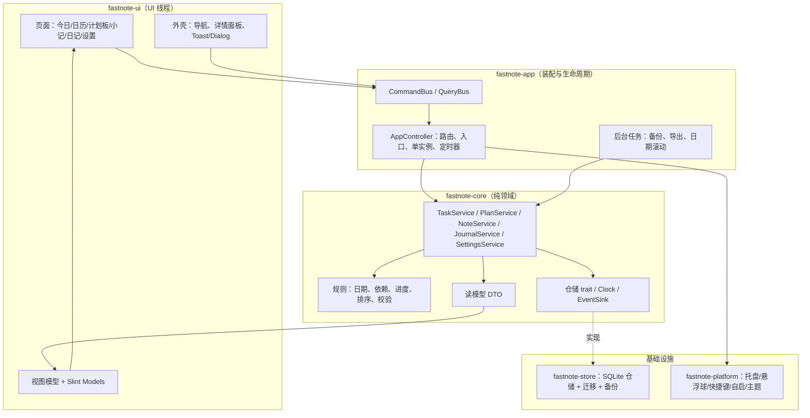

# ARCH-02 系统架构与数据流

> 文档编号：ARCH-02 ｜ 模块：00 总览与架构 ｜ 状态：已定稿 v0.1 ｜ 更新：2026-10-23
> 上游：[ARCH-01](01-tech-and-runtime.md) ｜ 下游：各功能模块、[ARCH-03](03-domain-model.md)、[ARCH-04](04-storage-and-data.md)

---

## 1. 目的与范围

定义 FastNote 的分层结构、模块边界、命令/查询流、跨模块一致性规则与扩展点，确保各功能模块按同一套机制实现，不出现多套任务状态或页面间不同步。

**范围内**：分层、依赖方向、服务接口职责、事件与刷新机制、错误处理、长任务、AI 扩展边界。
**范围外**：具体 SQL 与表结构（ARCH-04）、界面布局（SHELL-01）、单模块交互细节（各模块文档）。

---

## 2. 架构原则

1. **领域中心**：所有业务规则集中在 `fastnote-core`，UI 只负责展示与输入，不复制规则。
2. **单一事实来源**：SQLite 是唯一权威数据源；页面模型是只读投影，不允许长期持有可写副本。
3. **显式变更**：所有修改通过应用服务（command）执行，成功后发布领域事件；禁止 UI 直接改模型造成「界面已改、库里没改」。
4. **提示优先**：冲突/依赖/异常以提示与可视化标记呈现，不自动修改用户安排（D-17）。
5. **可替换边界**：存储、平台能力通过 trait 隔离，便于测试与未来扩展（含 AI Agent）。
6. **同步优先**：本地单用户场景下不使用最终一致性；命令返回即代表已提交。

---

## 3. 分层与模块边界



### 3.1 各层职责

| 层 | 职责 | 禁止 |
| --- | --- | --- |
| `fastnote-ui` | Slint 页面、组件、视图模型、输入校验的前置提示、Toast/Dialog 调用 | 直接访问 SQLite；实现业务规则；跨模块缓存可变实体 |
| `fastnote-app` | 依赖装配、路由/导航、窗口与入口生命周期、命令分发、后台任务调度 | 编写领域规则；直接写 SQL |
| `fastnote-core` | 实体、不变量、校验、派生计算、服务编排、事务边界声明、事件定义 | 依赖 UI/平台/具体存储 |
| `fastnote-store` | 实现仓储 trait、SQL、迁移、备份/恢复、完整性检查 | 反向依赖 core 之外的上层 |
| `fastnote-platform` | 托盘/悬浮球/快捷键/自启/单实例/主题检测 | 持有业务状态；直接改 UI 模型 |

### 3.2 依赖规则

```text
fastnote-app → fastnote-ui → fastnote-core
     │              │              ↑
     ├────→ fastnote-platform       │
     └────→ fastnote-store ─────────┘
```

- `fastnote-core` 只定义 `Repository` trait，不引用 `rusqlite`。
- `fastnote-ui` 通过 `AppFacade`（由 app 层注入）调用命令与查询，不依赖 store。
- 平台事件经 `AppController` 转为内部事件，再由 UI 订阅。

---

## 4. 核心接口

### 4.1 应用门面

```rust
/// UI 唯一入口；由 app 层实现，内部把命令投递到 DB 工作线程。
pub trait AppFacade: Send + Sync {
    fn execute(&self, cmd: Command, on_done: Box<dyn FnOnce(Result<CommandResult, AppError>) + Send>);
    fn query(&self, query: Query, on_done: Box<dyn FnOnce(Result<QueryResult, AppError>) + Send>);
    fn subscribe(&self, handler: Box<dyn Fn(AppEvent) + Send + Sync>);
    fn platform(&self) -> &dyn PlatformFacade;
}
```

- `execute` 立刻返回；结果通过回调回到 UI 线程。
- 同一实体的写命令串行执行（DB 工作线程天然串行）。
- 命令携带 `request_id` 与 `source`（页面/入口/快捷键），便于埋点与刷新范围判断（本地日志，不外发）。

### 4.2 命令与查询枚举（初始集合）

```rust
pub enum Command {
    // 任务
    CreateTask(CreateTask),
    UpdateTask(UpdateTask),
    SetTaskStatus { id: TaskId, status: TaskStatus },
    MoveTask(MoveTask),
    DeleteTask { id: TaskId, cascade: bool },
    ReorderTasks { parent: Option<TaskId>, ordered: Vec<TaskId> },
    AddDependency { task: TaskId, depends_on: TaskId },
    RemoveDependency { task: TaskId, depends_on: TaskId },
    // 计划/阶段
    CreatePlan(CreatePlan),
    UpdatePlan(UpdatePlan),
    ArchivePlan(PlanId),
    UnarchivePlan(PlanId),
    DeletePlan(PlanId),
    CreateStage(CreateStage),
    UpdateStage(UpdateStage),
    DeleteStage { id: TaskId, move_tasks_to_root: bool },
    // 小记/日记
    CreateNote { content: String },
    UpdateNote { id: NoteId, content: String },
    DeleteNote(NoteId),
    ConvertNoteToTask { note: NoteId, title: Option<String> },
    UnlinkNoteTask(NoteId),
    SaveJournal { date: NaiveDate, content: String },
    DeleteJournal(NaiveDate),
    // 提醒：owner 为 Task(TaskId) 或 Note(NoteId)
    UpsertReminder(UpsertReminder),
    PauseReminder(ReminderId),
    ResumeReminder(ReminderId),
    DeleteReminder(ReminderId),
    DispatchDueReminders { now: DateTime<Utc> }, // 内部命令，非 UI 主动调用
    // 设置与数据
    UpdateSettings(Vec<(SettingKey, SettingValue)>),
    CreateBackup { dest: PathBuf },
    RestoreBackup { source: PathBuf },
    ExportData { dest: PathBuf },
    ImportData { source: PathBuf, mode: ImportMode },
}

pub enum Query {
    Today { date: NaiveDate, limit_per_section: Option<u32> },
    CalendarMonth { year: i32, month: u32 },
    CalendarWeek { anchor: NaiveDate }, // 按 appearance.week_starts_on 归一到所在周
    ReminderFor { owner: ReminderOwner },
    NotificationStatus,
    DayAgenda { date: NaiveDate },
    TaskDetail(TaskId),
    TaskChildren { parent: TaskId },
    DependencyCandidates { plan_id: PlanId, task_id: TaskId },
    PlanList { archived: bool },
    PlanDetail(PlanId),
    NoteList { offset: usize, limit: usize },
    NoteDetail { id: NoteId },
    Journal { date: NaiveDate },
    JournalMonth { year: i32, month: u32 },
    Settings,
    StorageInfo,
}
```

> **设计决策 D-19：** 命令/查询采用枚举而非每个服务一个 trait 对象。枚举让 UI 与后台线程的边界显式、易于序列化调试，也便于未来 Agent 通过同一命令层提交「变更提案」。

### 4.3 结果与事件

```rust
pub struct CommandResult {
    pub affected_tasks: Vec<TaskId>,
    pub affected_plans: Vec<PlanId>,
    pub message: Option<UiMessage>, // 成功提示（可选）
}

pub enum AppEvent {
    TasksChanged { scope: TaskScope, affected: Vec<TaskId> },
    PlansChanged,
    PlanTreeChanged { plan_id: PlanId },
    NotesChanged,
    RemindersChanged { owners: Vec<ReminderOwner> },
    NotificationStateChanged,
    JournalChanged { date: NaiveDate },
    TodayChanged { date: NaiveDate },   // 本地日期跨日
    SettingsChanged { keys: Vec<SettingKey> },
    EntryStateChanged { mode: EntryMode, visible: bool },
    HotkeyStateChanged { registration: HotkeyRegistration },
    ThemeChanged { theme: ThemeMode, effective: EffectiveTheme },
    DataTaskProgress { id: u64, phase: DataPhase, percent: u8 },
    DataTaskFinished { id: u64, result: Result<DataOutcome, AppError> },
}
```

- 事件只表示「什么变了」，UI 收到后重新查询受影响范围，不做增量合并（数据量小、避免状态分叉）。
- `TaskScope`：`Today` / `Calendar` / `Plan(PlanId)` / `Detail(TaskId)` / `All`，用于避免无关刷新。
- **一次任务变更可以广播多条 `TasksChanged`**。例如修改一个属于计划 P 的任务日期：同时发出 `scope=Today`、`scope=Calendar`、`scope=Plan(P)`；各页面只处理与自己相关的 scope，不得假设一条事件覆盖全部影响面。服务层负责计算影响范围，UI 不自行推断。

---

### 4.4 提醒调度边界（v0.2）

`ReminderService` 属于 core，规则与去重账本写入仍走 DB worker；app 层的 `ReminderScheduler` 用最近到期计时器与 ≤30s 的恢复校验触发内部 `DispatchDueReminders`。提交领取记录后才交平台适配器投递，不在数据库事务内等待系统通知。平台回调只返回投递结果/点击目标，由 app 层校验 owner 存在后导航，不带正文入日志。

启动、唤醒检查最近 24 小时错过的 occurrence 并汇总，不把每条补发成独立系统通知。恢复/导入和退出必须暂停 dispatcher；恢复/导入重基线而非补历史。详情和接口载荷由 [REM-01](../11-reminders/01-reminders-and-notifications.md) 定义。`RemindersChanged` 刷新相应任务详情/小记铃铛与调度器；完成/归档/删除/跨计划移动必须事务内维护提醒资格。

## 5. 跨模块一致性

### 5.1 刷新矩阵

| 变更 | 今日任务 | 日历 | 计划板 | 任务详情 | 日记回顾 | 小记 |
| --- | --- | --- | --- | --- | --- | --- |
| 任务标题/描述/优先级 | 刷新 | 刷新 | 刷新 | 刷新 | — | — |
| 任务状态 | 刷新 | 刷新 | 刷新（进度/健康度） | 刷新 | 若在看当日则刷新 | — |
| 任务开始/完成日期 | 刷新 | 刷新 | 刷新（冲突检查） | 刷新 | 刷新 | — |
| 任务移动（父/阶段/计划） | 刷新 | 刷新 | 刷新（两棵树） | 刷新 | — | — |
| 任务删除 | 刷新 | 刷新 | 刷新 | 关闭面板 | 刷新 | — |
| 依赖新增/删除 | 刷新标记 | — | 刷新（问题列表） | 刷新 | — | — |
| 计划归档/恢复 | 刷新（移入/移出） | 刷新 | 刷新列表 | 若指向该计划任务则关闭或只读 | — | — |
| 计划日期变更 | — | 刷新冲突标记 | 刷新健康度 | — | — | — |
| 小记转任务 | 刷新（新任务出现在未安排） | — | — | — | — | 刷新关联 |
| 设置变更 | 按设置项刷新显示偏好 | 周起始日/显示偏好 | — | — | — | — |

### 5.2 一致性规则

1. 页面不得在本地保留「待同步队列」；命令失败时恢复为库中值并提示。
2. 写命令返回后，UI 必须等待 `TasksChanged/PlanTreeChanged` 事件再刷新，避免读到旧快照。
3. 详情面板打开时，若实体被删除，面板关闭并 Toast「任务已删除」。
4. 同一任务在多个页面展示的派生状态（逾期/阻塞/进度）必须由同一 core 函数计算，禁止页面各自判断。
5. 归档计划的任务在今日/日历查询中默认排除；日记回顾查询保留（D-09）。
6. 任务树移动在一个事务内完成；对子树的全量 `plan_id` 更新属于同一事务。

---

## 6. 路由与页面状态

```rust
pub enum Route {
    Today,
    Calendar { selected: NaiveDate },
    Notes { selected: Option<NoteId> },
    Journal { date: NaiveDate },
    PlanList { tab: PlanTab },
    PlanDetail { plan_id: PlanId, focus: Option<TaskId> },
    Settings { section: SettingsSection },
}
```

- 启动默认 `Today`；悬浮球左键打开时为 `Today`（若主窗已存在则恢复原路由，见 ENTRY-01）。
- 路由状态由 `AppController` 持有；切换页面保留各页面的临时状态（滚动位置、选中日期、展开的阶段）。
- 页面级查询参数变化 → 发起新查询，旧响应按 `request_id` 丢弃。
- 任务详情是全局覆盖层（overlay/drawer），不改变路由；关闭后回到原页面。

**详情面板状态**

```rust
pub struct DetailPanelState {
    pub target: DetailTarget,       // Task(TaskId) / Plan(PlanId)
    pub mode: DetailMode,           // View / Edit / Create
    pub return_focus: Option<UiFocus>,
}
```

- 同一时刻最多一个详情面板；打开新目标时替换。
- Esc 关闭；关闭前若有未提交的标题编辑，失焦即提交（不弹保存框）。

---

## 7. 错误处理与提示映射

```rust
pub enum AppError {
    Validation { code: ErrorCode, field: Option<Field>, detail: Option<String> },
    NotFound { entity: EntityKind, id: String },
    Conflict { code: ErrorCode, related: Vec<String> },
    Storage { code: StorageErrorCode, log_id: String },
    Platform { code: PlatformErrorCode, detail: String },
    Cancelled,
}
```

| 类别 | UI 呈现 | 示例 |
| --- | --- | --- |
| Validation | 字段下方 inline 错误，保留输入 | 标题为空、开始日期晚于完成日期 |
| Conflict（可继续） | 非阻塞确认/提示，用户可选择继续 | 前置任务未完成即开始、日期越出计划范围 |
| Conflict（阻断） | 弹窗说明原因，不落库 | 依赖成环、移动到自身子节点、计划未归档即删除 |
| NotFound | Toast + 刷新/关闭面板 | 任务已被删除 |
| Storage | 页面横幅 + 重试入口 + 日志 ID | 磁盘满、数据库只读 |
| Platform | 设置项 inline 错误 + 恢复原值 | 快捷键被占用、自启注册失败 |

- 内部错误详情只写日志；界面显示可执行的中文文案。
- 每个错误码对应固定文案键，集中在 `fastnote-ui` 文案表。

---

## 8. 长任务与取消

| 任务 | 线程 | 进度 | 取消语义 |
| --- | --- | --- | --- |
| 创建备份 | DB worker / 短任务线程 | 分阶段（准备/复制/校验） | 取消后删除未完成临时文件 |
| 恢复备份 | 短任务线程 + 重启 | 分阶段 | 校验完成前可取消；替换数据库后不可取消 |
| 导出 JSON | 短任务线程 | 按实体计数 | 取消删除临时文件 |
| 导入 JSON | DB worker | 按实体计数 | 事务回滚，不留半份数据 |
| 数据库迁移 | DB worker | 无 | 不可取消；失败回滚并保留备份 |

- 进度通过 `DataTaskProgress` 事件推送，UI 显示模态进度框（可取消时提供按钮）。
- 长任务期间禁止发起第二个数据管理任务，其他业务功能可继续使用（恢复除外）。

---

## 9. 为 AI Agent 预留的边界（第一版不实现）

第一版**不实现** MCP、LLM 调用、自动执行，只保证结构可扩展：

1. **只读查询层**：`Query` 已覆盖今日、计划详情、任务树、进度、依赖；未来 Agent 可直接复用。
2. **变更提案层**：所有写操作是显式 `Command`，未来可构造 `ChangeProposal { commands, rationale, risks }`，先展示 diff，用户确认后执行。
3. **批量操作约束**：涉及删除、批量改期、计划重构的命令必须支持「预演（dry-run）」；当前由服务层统一走事务，可在未来加 `preview()`。
4. **依赖语义**：依赖只提示不锁定（D-17），Agent 不得默认绕过提示；若用户确认提前开始，命令需记录 `override_reason`（未来字段，v1 不加表）。
5. **授权边界**：未来 Agent 以本地只读连接或 `Query` 接口访问，不直接连接数据库文件。
6. **不改核心结构**：Agent 能力不得要求改变「计划—阶段—任务」模型或页面组织。

> **待确认 Q-02：** 未来 Agent 是否需要独立的审计日志（记录谁发起了哪次批量修改）。当前默认：v1 不建审计表；未来通过 `Command` 携带 `source` 字段扩展。

---

## 10. 可测试性与可观测性

- `fastnote-core` 的服务可注入内存仓储与固定 `Clock`，覆盖跨日、跨时区、逾期、进度、依赖规则。
- `fastnote-store` 使用临时目录 + 真实 SQLite 做集成测试，覆盖迁移、事务回滚、并发读、备份恢复。
- UI 通过视图模型测试（无渲染）覆盖状态映射；关键页面做 Slint 渲染冒烟。
- 日志包含：启动耗时、DB 迁移版本、命令耗时（>50ms 记 warn）、长任务进度、平台注册结果；不包含正文。

---

## 11. 验收标准

| 编号 | 验收标准 |
| --- | --- |
| AC-ARCH-09 | 任一页面修改任务后，今日/日历/计划板在 200ms 内展示一致结果。 |
| AC-ARCH-10 | UI 层不存在直接 SQL 或直接改仓储的调用（CI 架构检查/代码评审）。 |
| AC-ARCH-11 | 删除正在详情面板展示的任务，面板自动关闭且无崩溃。 |
| AC-ARCH-12 | 命令失败时界面回滚到数据库值，并给出可读错误，不出现半更新。 |
| AC-ARCH-13 | 长任务可取消，取消后无临时文件残留、无半份导入数据。 |
| AC-ARCH-14 | 归档计划后，其任务从今日/日历消失，日记历史回顾仍可见。 |
| AC-ARCH-15 | 新增一个查询/命令不需要修改其他模块的实现，只需扩展枚举与分发。 |

---

## 12. 待确认问题

以下为本文件中所有未决问题的索引（正文见对应章节）：

| 编号 | 位置 | 问题摘要 | 当前默认处理 |
| --- | --- | --- | --- |
| Q-02 | §9 | 未来 AI Agent 是否需要独立审计日志 | v1 不建审计表；`Command` 预留 `source` 字段 |
