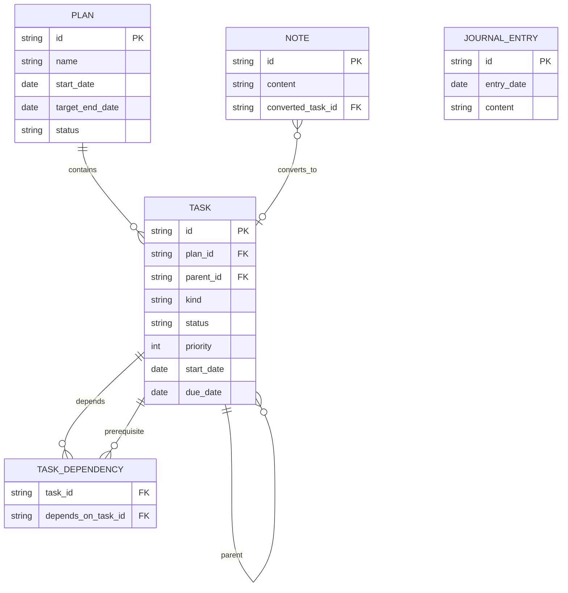

# ARCH-03 领域模型与业务规则

> 文档编号：ARCH-03 ｜ 模块：00 总览与架构 ｜ 状态：已定稿 v0.1 ｜ 更新：2026-10-23
> 上游：[ARCH-02](02-architecture.md) ｜ 下游：全部功能模块（**唯一事实来源**）

---

## 1. 目的与范围

定义 FastNote 的实体、字段、状态、不变量、派生规则与读模型。所有页面（今日任务、日历、计划板、日记回顾）必须调用本文定义的规则，禁止各自实现「逾期」「进度」「阻塞」等判断。

**范围内**：计划、阶段、任务、依赖、小记、日记的领域模型；状态机；日期语义；进度/健康度；删除与归档；排序；校验与错误码；读模型 DTO。
**范围外**：SQL 表结构与索引（ARCH-04）、界面呈现（各模块文档）、导入导出文件格式（DATA-03）。

---

## 2. 模型总览



### 2.1 树形结构

```text
计划（Plan）
├── 阶段 A（kind=stage，parent=NULL，plan_id=P）
│   ├── 任务 A1（kind=task，parent=A）
│   │   └── 任务 A1.1（任意层级）
│   └── 任务 A2
├── 阶段 B
│   └── …
└── 未分组任务 C（kind=task，parent=NULL，plan_id=P）

独立任务 D（kind=task，plan_id=NULL，parent=NULL）
└── 子任务 D1
```

- **任务树是全产品唯一的层级结构**；今日任务、日历、计划板展示的是同一批任务。
- 阶段只是计划根下的一类节点，用于路线图分组；**阶段不能嵌套阶段**。
- 计划根下可以直接挂任务（「未分组任务」），不强制归属阶段（product §4.5）。
- 计划之外可以有独立的任意层级任务树。

---

## 3. 实体定义

### 3.1 Plan（计划）

| 字段 | 类型 | 必填 | 默认 | 规则 |
| --- | --- | --- | --- | --- |
| `id` | PlanId (UUIDv7) | 是 | 应用生成 | 全局唯一 |
| `name` | string | 是 | — | 去首尾空白，1–100 字符 |
| `description` | string | 否 | `""` | ≤ 2,000 字符 |
| `start_date` | `Option<NaiveDate>` | 否 | `NULL` | 与 `target_end_date` 同时存在时必须 `start ≤ end` |
| `target_end_date` | `Option<NaiveDate>` | 否 | `NULL` | 同上 |
| `status` | `PlanStatus` | 是 | `active` | `active` / `archived` |
| `sort_order` | i64 | 是 | 1024 递增 | 计划列表手动排序 |
| `archived_at` | `Option<DateTime<Utc>>` | 否 | `NULL` | 归档时写入，恢复时清空 |
| `created_at` / `updated_at` | `DateTime<Utc>` | 是 | now | 任何字段变更更新 `updated_at` |

### 3.2 Task（任务/阶段）

| 字段 | 类型 | 必填 | 默认 | 规则 |
| --- | --- | --- | --- | --- |
| `id` | TaskId (UUIDv7) | 是 | 应用生成 | 全局唯一 |
| `plan_id` | `Option<PlanId>` | 否 | `NULL` | 计划内节点必须有值；独立任务为 `NULL` |
| `parent_id` | `Option<TaskId>` | 否 | `NULL` | 父节点同属一个计划；不能成环 |
| `kind` | `TaskKind` | 是 | `task` | `task` / `stage` |
| `title` | string | 是 | — | 去空白，1–200 字符 |
| `description` | string | 否 | `""` | ≤ 10,000 字符 |
| `status` | `Option<TaskStatus>` | 任务必填 | `todo` | 阶段必须为 `NULL`（D-08） |
| `priority` | `Priority` | 是 | `none` | 阶段固定 `none`，UI 不展示 |
| `start_date` | `Option<NaiveDate>` | 否 | `NULL` | 计划开始日期 |
| `due_date` | `Option<NaiveDate>` | 否 | `NULL` | 计划完成日期 |
| `completed_at` | `Option<DateTime<Utc>>` | 否 | `NULL` | 仅 `status=done` 时有值 |
| `status_changed_at` | `DateTime<Utc>` | 是 | now | 状态变更时更新，用于「等待 N 天」 |
| `sort_order` | i64 | 是 | 追加 | 同父节点内手动排序 |
| `created_at` / `updated_at` | `DateTime<Utc>` | 是 | now | 字段变更更新 `updated_at` |

**字段补充说明**

- `title` 与 `description` 使用纯文本，不支持 HTML/Markdown 语法解析（第一版）。
- `status_changed_at` 在创建时等于 `created_at`；任何状态变化（含 done → todo）都刷新。
- 阶段没有 `status`，其完成度由进度表达；阶段的 `priority` 固定为 `none`。
- `plan_id` 是**冗余字段**，用于快速查询与权限判断；任何移动操作必须在同一事务内更新整棵子树的 `plan_id`，并由仓储层校验一致性（INV-02）。

### 3.3 TaskDependency（任务依赖）

| 字段 | 类型 | 规则 |
| --- | --- | --- |
| `task_id` | TaskId | 后继任务；`kind=task` |
| `depends_on_task_id` | TaskId | 前置任务；`kind=task` |
| `created_at` | DateTime | 创建时间 |

- 语义：`task` 应在 `depends_on` 完成后开展。
- 两任务必须属于**同一计划**且 `plan_id` 非空。
- 不允许自依赖、祖先/后代依赖、成环。
- 依赖仅用于提示与可视化，不改变任务状态、不锁定操作（product §4.5）。
- 删除任一任务时相关依赖级联删除。

### 3.4 Note（小记）

| 字段 | 类型 | 必填 | 规则 |
| --- | --- | --- | --- |
| `id` | NoteId | 是 | UUIDv7 |
| `content` | string | 是 | 去空白后非空；≤ 20,000 字符 |
| `converted_task_id` | `Option<TaskId>` | 否 | 一对一关联；任务删除后置 `NULL` |
| `created_at` / `updated_at` | DateTime | 是 | `updated_at` 用于列表排序 |

- 不设标题字段；列表标题取首个非空行，截断 80 字符。
- 内容原样保存（保留换行），仅在首尾去空白后判空。

### 3.5 JournalEntry（日记）

| 字段 | 类型 | 必填 | 规则 |
| --- | --- | --- | --- |
| `id` | JournalId | 是 | UUIDv7 |
| `entry_date` | `NaiveDate` | 是 | 本地日期，**全局唯一** |
| `content` | string | 是 | 去空白后非空；≤ 50,000 字符 |
| `created_at` / `updated_at` | DateTime | 是 | — |

- 每个自然日最多一篇（D-12）。
- 空内容不创建条目；已有条目内容被清空后删除该条目。

### 3.6 设置与其它

设置项、数据文件等见 [ARCH-04](04-storage-and-data.md)。领域层只负责读取强类型配置值。

---

## 4. 枚举与状态

### 4.1 TaskKind

| 值 | 中文 | 说明 |
| --- | --- | --- |
| `task` | 任务 | 可执行单元，有状态、优先级、依赖 |
| `stage` | 阶段 | 计划分组节点，只有日期与进度，无状态/优先级/依赖 |

### 4.2 TaskStatus

| 值 | 中文 | 语义 | 与日期关系 |
| --- | --- | --- | --- |
| `todo` | 待处理 | 尚未开始 | 可无日期、可逾期 |
| `in_progress` | 进行中 | 正在执行 | 可无日期 |
| `waiting` | 等待中 | 等待他人/外部反馈 | 可逾期，保留原始截止日期 |
| `done` | 已完成 | 已结束 | 写入 `completed_at` |

- 四种状态之间**允许任意直接切换**，不设强制流转（product §5.3、§5.6）。
- 状态与日期相互独立：系统不因日期自动改状态，也不因状态自动改日期。
- 状态变更不触发父任务/阶段状态（阶段无状态；父任务不自动完成）。

### 4.3 Priority

| 值 | 数值 | 中文 | 颜色语义 |
| --- | --- | --- | --- |
| `none` | 0 | 无 | 不显示标记 |
| `low` | 1 | 低 | 蓝灰 |
| `medium` | 2 | 中 | 琥珀 |
| `high` | 3 | 高 | 红 |

排序时数值越大越靠前。

### 4.4 PlanStatus

| 值 | 中文 | 行为 |
| --- | --- | --- |
| `active` | 进行中 | 正常读写；任务进入今日/日历 |
| `archived` | 已归档 | 只读；任务不进入今日/日历；保留历史与日记回顾 |

### 4.5 状态机

```text
            ┌─────────────────────────────┐
            ▼                             │
  [todo] ⇄ [in_progress] ⇄ [waiting]      │
     ⇅          ⇅              ⇅          │
     └──────── [done] ────────────────────┘
```

- 进入 `done`：写 `completed_at = now`，`status_changed_at = now`。
- 离开 `done`：清空 `completed_at`，刷新 `status_changed_at`。
- 其它状态切换：仅刷新 `status_changed_at`，不触碰日期。
- 归档计划的任何任务状态修改均被拒绝（`E_PLAN_ARCHIVED`）。

---

## 5. 不变量（Invariants）

| 编号 | 不变量 | 违反处理 |
| --- | --- | --- |
| INV-01 | 所有实体 ID 全局唯一 | 数据库主键冲突 → `E_CONFLICT` |
| INV-02 | 计划内任意节点的 `plan_id` 与其祖先一致 | 事务内校验；不一致拒绝保存 |
| INV-03 | `kind=stage` 必须 `plan_id NOT NULL` 且 `parent_id IS NULL` | `E_STAGE_PARENT_INVALID` |
| INV-04 | 任务树不得成环；节点不能移动到自身或后代 | `E_MOVE_INTO_DESCENDANT` |
| INV-05 | `kind=stage` 的 `status IS NULL`、`priority=none` | 领域层强制 |
| INV-06 | `kind=task` 的 `status` 必须为四态之一 | 数据库 CHECK + 领域校验 |
| INV-07 | 任何节点 `start_date ≤ due_date`（两者都有时） | `E_DATE_RANGE` |
| INV-08 | 依赖两端必须为同计划的 `kind=task`，且非自身、非祖先/后代、无环；单任务前置 ≤20 | `E_DEP_*`（含 `E_DEP_LIMIT`） |
| INV-09 | `journal_entries.entry_date` 唯一 | `E_JOURNAL_DUP`（内部） |
| INV-10 | `note.converted_task_id` 指向存在的任务或 `NULL` | 外键 `ON DELETE SET NULL` |
| INV-11 | 归档计划及其中节点只读 | `E_PLAN_ARCHIVED` |
| INV-12 | `status=done` ⇔ `completed_at IS NOT NULL` | 事务内同步维护 |
| INV-13 | `sort_order > 0`；同父节点内可重复但不建议 | 归一化时重排 |
| INV-14 | 计划 `start_date ≤ target_end_date`（两者都有时） | `E_PLAN_DATE_RANGE` |
| INV-15 | 计划内节点不能挂到其它计划/独立树；独立任务不能直接挂计划内节点 | 移动命令校验 |
| INV-16 | 依赖不允许跨计划 | `E_DEP_CROSS_PLAN` |
| INV-17 | 阶段不能有子阶段 | `E_STAGE_CHILD_STAGE` |

> **设计决策 D-20：** 采用「父节点记录树结构 + `plan_id` 冗余」而非闭包表。数据规模 ≤1 万任务，递归查询（CTE）足够；冗余 `plan_id` 让今日/日历查询无需递归。所有移动由服务层统一维护冗余字段。

---

## 6. 日期与时间规则

1. **业务日期无时区**：`start_date`、`due_date`、`entry_date` 均为 `NaiveDate`，按设备本地日历理解。
2. **时间戳统一 UTC**：`created_at`、`updated_at`、`completed_at`、`status_changed_at` 存 RFC 3339 UTC；界面显示本地时间。
3. **今天**：由注入的 `Clock` 返回本地日期；应用每 30s 检查日期是否变化，变化时广播 `TodayChanged` 并刷新「今日」「日历」。
4. **逾期**：`due_date < today && status != done && 所属计划未归档`。
5. **等待天数**：`today - local_date(status_changed_at)`，最小 0；仅当 `status=waiting` 时展示。
6. **完成于今日**：`status=done && local_date(completed_at) == today`。
7. **夏令时**：日期加减使用 `chrono` 的日历运算，不假设每天 24 小时；跨时区不改变已存日期。
8. **日期输入**：UI 使用日期选择器，允许清空；手输格式必须为 `YYYY-MM-DD`，非法输入不提交。
9. **周起始日**：默认周一，可在设置改为周日（仅影响日历渲染，不影响数据）。
10. **范围**：可选日期限定 `1900-01-01`–`9999-12-31`；越界拒绝（`E_DATE_RANGE`）。

---

## 7. 生命周期与操作语义

### 7.1 创建

| 场景 | 默认值 |
| --- | --- |
| 今日页快速添加 | `status=todo`，无日期、无优先级、无计划 |
| 日历某日新建 | `due_date=选中日期`，其余默认 |
| 计划板新建 | `plan_id=当前计划`；在阶段下创建则 `parent_id=阶段` |
| 小记转任务 | 标题取小记首行，描述取全文，无日期/优先级 |
| 快捷键新建 | 同今日快速添加，并聚焦输入框 |

- 标题是唯一必填项；创建后立即落库并返回任务 ID。
- 在阶段下创建任务时，客户端只需传 `parent_id`，服务端补齐 `plan_id`。
- 新建节点的 `sort_order = 当前同父最大 sort_order + 1024`。

### 7.2 更新

- 采用补丁语义 `Patch<T>`：`Keep` / `Set(value)` / `Clear`，用于区分「不修改」与「清空日期/计划」。
- 任何更新在一个事务内完成，更新 `updated_at`。
- 状态更新单独走 `SetTaskStatus`，以保证 `completed_at`、`status_changed_at` 一致。
- 批量更新（如计划日期变更后检查冲突）只产生提示，不级联修改任务日期。

### 7.3 移动

| 操作 | 规则 |
| --- | --- |
| 任务 → 另一阶段/计划根 | 更新 `parent_id`、整棵子树 `plan_id`；日期不变；追加到目标末尾 |
| 任务 → 另一计划 | 同上；跨计划依赖需用户确认后解除（`E_DEP_CROSS_PLAN` 提示） |
| 任务 → 移出计划 | `plan_id=NULL`、`parent_id=NULL`；日期保留；解除全部依赖 |
| 任务 → 另一任务下 | 目标不能是自身后代；继承目标 `plan_id` |
| 阶段排序 | 只能调整同计划内阶段顺序，不能移动阶段到其它层级 |
| 移动后冲突 | 返回 `warnings`（日期越出计划范围、依赖日期冲突、目标阶段无日期等），UI 以 Toast/标记提示，不阻止 |

- 移动不改变任务状态、完成时间、依赖（除非跨计划/移出计划）。
- 移动一个「已完成父任务 + 未完成子任务」的子树保持原状。

### 7.4 完成与父任务

- 完成任务时不自动完成父任务；若所有子任务完成，Toast 提示「子任务已全部完成，是否将父任务标记完成？」（可操作，不自动）。
- 父任务仍有未完成子任务时标记完成：弹确认，确认后允许，界面在父任务行展示「含未完成子任务」提示。
- 阶段没有完成操作；阶段显示进度百分比，进度 100% 时显示「已完成」徽标（派生）。

### 7.5 删除

| 对象 | 规则 |
| --- | --- |
| 任务（无子任务） | 确认后硬删除；依赖边级联删除 |
| 任务（有子任务） | 必须明确 `cascade=true`；确认框展示「将删除 N 个任务」；否则 `E_HAS_CHILDREN` |
| 阶段 | 二选一：`move_tasks_to_root=true` 将直接子任务（含其子树）移到计划根；或 `false` 级联删除阶段及全部任务 |
| 计划 | **必须先归档**；删除归档计划需二次确认（展示任务数量）；级联删除任务、依赖 |
| 小记 | 确认后硬删除；已转换任务不受影响 |
| 日记 | 确认后删除当日条目 |

- 删除是硬删除，第一版不提供回收站（D-11）。
- 删除正在展示的实体时，详情面板关闭并提示。

### 7.6 归档

- 归档：`status=archived`，`archived_at=now`；计划及其任务进入只读。
- 归档不改变任务状态、日期、进度快照（进度按当前数据计算，归档后不再变化）。
- 归档计划的任务从今日/日历查询排除；日记的「当日完成/到期」回顾仍包含（D-09）。
- 恢复：`status=active`，`archived_at=NULL`；任务重新进入今日/日历；逾期重新计算。
- 归档前若有未完成任务，确认框提示数量；不阻止归档。

---

## 8. 派生规则

所有派生函数集中在 `fastnote-core::derive`，输入为实体 + `today`，输出稳定、可单测。

### 8.1 逾期

```text
is_overdue(task, today) =
  task.kind == task
  && task.status != done
  && task.due_date.is_some()
  && task.due_date < today
  && plan_of(task) 未归档
```

- 无截止日期永不逾期。
- 阶段逾期（路线图健康度）：`stage.due_date < today && stage 进度 < 100% && stage 有叶子任务`。

### 8.2 今日视图（TodayView）

按以下**优先级顺序**分组，每个任务只出现在第一个命中的分组（去重）：

| 顺序 | 分组 `TodaySectionKind` | 命中条件（排除归档计划） |
| --- | --- | --- |
| 1 | `overdue` 逾期 | `is_overdue` |
| 2 | `due_today` 今日到期 | `status != done && due_date == today` |
| 3 | `starts_today` 今日开始 | `status != done && start_date == today`，且未命中 1–2 |
| 4 | `in_progress` 进行中 | `status == in_progress`，且未命中 1–3，且 `start_date` 为空或 `≤ today`，且 `due_date` 为空或 `> today` |
| 5 | `waiting` 等待中 | `status == waiting`，且未命中 1–4 |
| 6 | `unscheduled` 未安排 | `status == todo && start_date IS NULL && due_date IS NULL`，且未命中 1–5 |
| 7 | `tomorrow` 明日预告 | `status != done && (due_date == tomorrow || start_date == tomorrow)`，且未命中 1–6 |
| 8 | `completed_today` 今日已完成 | `status == done && local_date(completed_at) == today` |

**补充规则**

- 分组 1–7 只包含未完成任务；分组 8 单独统计，默认折叠。
- 明日预告默认折叠（设置 `today.tomorrow_collapsed`，默认 `true`）。
- 空分组不展示；若 1–7 全为空，展示页面级空态。
- 页面顶部统计：`open_count` = 当前启用的 1–7 分组去重后的任务数（被 `today.show_*` 隐藏的分组不计入）；`overdue_count`；`completed_today_count`。
- 任务行同时展示其状态徽标（例如逾期且等待中 → 逾期分组 + 「等待中」徽标）。
- 归档计划任务不参与 1–8；`completed_today` 也不包含归档计划任务（今日页只关心当前工作）。

### 8.3 日历视图

**月格（DayCell）**

- `active_count`：当天**到期或开始**的未完成任务数。
- `overdue_count`：`due_date < today` 且未完成、到期日落在该格的任务数（用于历史格红点）。
- `completed_count`：当天完成的任务数（用于格子弱提示，可选展示）。
- 每格最多展示 2 条任务摘要，其余显示 `+N`。
- 归档计划任务排除。

**日面板（DayAgenda）**

| 分组 | 条件 |
| --- | --- |
| `due` 到期 | `due_date == date && status != done` |
| `start` 开始 | `start_date == date && status != done`，且未在 `due` |
| `ongoing` 进行中 | `status == in_progress && start_date < date && (due_date >= date || due_date IS NULL)`，且未在 `due/start` |
| `completed` 已完成 | `status == done && local_date(completed_at) == date` |

- 归档计划任务排除（`completed` 也排除）。
- `overload`：`due + start + ongoing` 数量 > 8 时置 `true`，日面板提示「当天安排较多」（提示，不阻止）。
- 跨天任务只在其开始/截止日进入月格；日面板的「进行中」分组用于查看执行中的跨天任务。

### 8.4 阻塞与依赖

```text
is_blocked(task) = 存在依赖边 task -> p，且 p.status != done
```

- 前置任务全部完成（或依赖已删除）→ 不再阻塞。
- 阻塞状态仅影响展示（图标、详情提示、计划问题列表），不改变任务状态，不禁止任何操作。
- 开始阻塞任务时（`todo/waiting → in_progress`）必须弹出非阻塞确认；用户确认后正常保存。
- 标记阻塞任务为完成时给一次性提示，用户确认后保存。
- 依赖日期冲突（`W_DEP_DATE`）：`p.due_date` 存在，且
  - `task.start_date` 存在且 `task.start_date < p.due_date`；或
  - `task.start_date` 为空、`task.due_date` 存在且 `task.due_date < p.due_date`。
- 依赖只允许同计划、`kind=task`；计划移动导致跨计划时，需用户确认解除跨计划依赖。

### 8.5 进度

```text
leaf(task) = kind == task && 无子节点
progress(nodes) = { done: 叶子任务中 status=done 的数量,
                    total: 叶子任务总数,
                    percent: total == 0 ? None : floor(done * 100 / total) }
```

- **阶段进度** = 该阶段子树内叶子任务。
- **计划进度** = 计划内全部叶子任务（含未分组任务）。
- **父任务**不展示百分比进度，只展示子任务完成数 `done/total`（直接子节点）。
- 叶子任务若被标记完成即为已计入；父任务自身状态不参与进度计算。
- 总数为 0：阶段显示「暂无任务」，计划进度显示 0%（`None` 状态，不显示 100%）。
- 百分比向下取整，只有 `done == total && total > 0` 时显示 100%。
- 归档计划保留归档时的数据，进度按归档数据计算（只读）。

### 8.6 计划健康度

| 问题码 | 级别 | 条件 |
| --- | --- | --- |
| `PLAN_OVERDUE` | critical | `target_end_date < today && progress` 存在且 `< 100%` |
| `PLAN_BEHIND` | warning / critical | 计划起止都有、跨度 ≥ 3 天、`today` 在区间内、进度存在；`gap = 已过时间比例 - 进度比例`；`gap ≥ 0.2` warning，`≥ 0.4` critical |
| `TASK_OVERDUE` | warning | 计划内未完成任务 `due_date < today`；按任务逐条列出或聚合计数 |
| `STAGE_OVERDUE` | warning | 阶段 `due_date < today` 且阶段进度 < 100% 且有任务 |
| `DATE_OUT_OF_PLAN` | warning | 任务/阶段日期早于计划开始或晚于计划目标结束 |
| `DEP_DATE_CONFLICT` | warning | §8.4 定义的依赖日期冲突 |
| `EMPTY_STAGE` | info | 阶段没有任何叶子任务 |
| `PLAN_STALLED` | info | 计划子树最近 `updated_at` 早于 14 天前，且进度 < 100% |

- 进度为 `None`（无任务）时，`PLAN_BEHIND` 不判定，`EMPTY_STAGE` 对每个空阶段提示。
- 计算以本地「今天」为准；归档计划不产生问题。
- 计划头部展示问题汇总数量，点击展开列表；任务行展示对应图标。

### 8.7 计数与辅助派生

- `open_count`：未完成任务数（按查询范围）。
- `overdue_count`：§8.1 计数。
- `waiting_days`：当前等待天数。
- `child_total` / `child_done`：直接子任务数与其中完成数。
- `descendant_leaf_total` / `descendant_leaf_done`：子树叶子统计（用于阶段/计划进度）。
- `read_only`：所属计划已归档。

---

## 9. 排序规则

| 列表 | 排序（优先级从高到低） |
| --- | --- |
| 今日：逾期 / 今日到期 / 今日开始 / 进行中 | 优先级降序 → `due_date` 升序（空值最后）→ `start_date` 升序（空值最后）→ `created_at` 升序 |
| 今日：等待中 | `status_changed_at` 升序（等待最久在前）→ 优先级降序 |
| 今日：未安排 | 优先级降序 → `created_at` 降序（新任务在前） |
| 今日：明日预告 | 同「今日到期」规则 |
| 今日：已完成 | `completed_at` 降序 |
| 日历日面板 | 同今日对应分组规则；`ongoing` 按 `start_date` 升序 → 优先级降序 |
| 计划板任务树 | 同父节点内 `sort_order` 升序 → `created_at` 升序 |
| 计划列表（进行中） | `sort_order` 升序 → `created_at` 降序 |
| 计划列表（已归档） | `archived_at` 降序 |
| 阶段列表 | `sort_order` 升序 |
| 小记列表 | `updated_at` 降序 |
| 日记浏览列表 | `entry_date` 降序 |
| 依赖选择器 | 同计划内按阶段顺序 → 任务树先序 |

**默认排序设置**（`tasks.default_sort`）只影响今日四个日期类分组的排序：

- `priority`（默认）：优先级 → 截止日期。
- `due_date`：截止日期（空值最后）→ 优先级。
- `created_desc`：创建时间倒序。

等待中、已完成分组不受该设置影响。

---

## 10. 校验与错误码

### 10.1 错误（阻止保存）

| 错误码 | 触发 | 用户文案（示例） |
| --- | --- | --- |
| `E_TITLE_REQUIRED` | 标题去空白后为空 | 请输入任务标题 |
| `E_TITLE_TOO_LONG` | 标题 > 200 字符 | 标题最多 200 个字符 |
| `E_DESC_TOO_LONG` | 描述 > 10,000 字符 | 描述过长，请精简后保存 |
| `E_DATE_RANGE` | 节点 `start > due` | 开始日期不能晚于完成日期 |
| `E_PLAN_DATE_RANGE` | 计划 `start > target_end` | 计划开始日期不能晚于目标结束日期 |
| `E_STAGE_PARENT_INVALID` | 阶段设置父节点或缺少计划 | 阶段必须直接属于某个计划 |
| `E_STAGE_CHILD_STAGE` | 阶段下创建阶段 | 阶段内不能创建子阶段 |
| `E_MOVE_INTO_DESCENDANT` | 移动到自身或后代 | 不能把任务移动到它自己或子任务下 |
| `E_DEP_SELF` | 自依赖 | 任务不能依赖自身 |
| `E_DEP_CYCLE` | 依赖成环 | 该依赖会形成循环 |
| `E_DEP_CROSS_PLAN` | 跨计划/独立任务依赖 | 只能为同一计划内的任务添加依赖 |
| `E_DEP_ANCESTOR` | 与祖先/后代建立依赖 | 父子任务之间不能设置依赖 |
| `E_DEP_LIMIT` | 单任务前置依赖达到 20 个上限 | 每个任务最多 20 个前置任务 |
| `E_HAS_CHILDREN` | 删除有子任务的节点但未确认级联 | 该任务包含子任务，请确认删除范围 |
| `E_PLAN_NOT_ARCHIVED` | 删除未归档计划 | 请先归档计划，再删除 |
| `E_PLAN_ARCHIVED` | 修改归档计划内数据 | 计划已归档，仅供查看 |
| `E_NOT_FOUND` | 实体不存在 | 内容已不存在，请刷新 |
| `E_JOURNAL_DUP` | 同日重复创建（内部） | —（服务层应更新而非插入） |
| `E_NOTE_EMPTY` | 小记内容为空 | 请输入内容 |
| `E_NOTE_TOO_LONG` | 小记 > 20,000 字符 | 小记内容过长 |
| `E_JOURNAL_TOO_LONG` | 日记 > 50,000 字符 | 日记内容过长 |
| `E_NOTE_ALREADY_CONVERTED` | 已关联任务再次转换 | 该小记已转为任务，请先解除关联 |
| `E_CONFLICT` | 并发/唯一约束冲突 | 内容已变化，请刷新后重试 |
| `E_HOTKEY_FORMAT` | 快捷键语法非法、超长、修饰键重复 | 快捷键格式无效 |
| `E_HOTKEY_NEEDS_MODIFIER` | 只有主键、没有修饰键 | 请至少使用一个修饰键 |
| `E_HOTKEY_INCOMPLETE` | 只有修饰键、没有主键 | 请再按一个字母、数字或功能键 |
| `E_HOTKEY_UNSUPPORTED_KEY` | 方向键、标点、媒体键等 | 该按键不支持 |
| `E_HOTKEY_DUPLICATE` | 与另两个动作组合重复 | 该组合已用于其他动作 |
| `E_HOTKEY_OCCUPIED` | 注册被系统/其它程序占用 | 该组合已被占用，请更换 |
| `E_HOTKEY_RESERVED` | 系统保留组合 | 该组合由系统保留 |
| `E_HOTKEY_REGISTER_FAILED` | 其它平台注册失败 | 快捷键注册失败，请重试 |
| `E_HOTKEY_UNSUPPORTED_PLATFORM` | Wayland 等不支持全局快捷键 | 当前桌面环境不支持全局快捷键 |
| `E_STORAGE_FULL` | 磁盘空间不足 | 磁盘空间不足，无法保存 |
| `E_STORAGE_CORRUPT` | 数据库损坏 | 数据文件异常，请从备份恢复 |
| `E_STORAGE_READONLY` | 数据目录/文件不可写或只读挂载 | 无法写入数据文件，请检查目录权限 |
| `E_STORAGE_LOCKED` | 数据库被外部程序占用（busy_timeout 到期） | 数据文件被其他程序占用，请关闭后重试 |
| `E_STORAGE_PATH_INVALID` | 数据/备份目录非法或无法创建 | 该文件夹不可用，请选择其他位置 |
| `E_STORAGE_IO` | 其他打开/读写 IO 失败 | 读写数据文件失败 |
| `E_SCHEMA_TOO_NEW` | 数据库版本高于应用支持版本 | 数据由更高版本创建，请升级应用 |
| `E_BACKUP_INVALID` | 备份文件扩展名/文件头/`app_id`/必需表不符 | 这不是有效的 FastNote 备份文件 |
| `E_BACKUP_VERSION` | 备份 schema 高于当前支持版本 | 备份由更高版本创建，请先升级 FastNote |
| `E_BACKUP_CORRUPT` | 备份打开失败、完整性/外键检查失败、版本字段矛盾 | 备份文件已损坏，无法恢复 |
| `E_BACKUP_FAILED` | 备份创建中的 IO/rename/元数据错误 | 备份失败，请检查磁盘空间与目录权限 |
| `E_RESTORE_FAILED` | 安全备份失败、替换或重启阶段失败（已回滚） | 恢复未完成，当前数据未被修改 |
| `E_DATA_TASK_BUSY` | 已有数据管理任务运行 | 请等待当前数据任务完成 |
| `E_IMPORT_FORMAT` | JSON 语法错误、`format` 不符、非 UTF-8 | 文件格式不正确，请选择 FastNote 导出的 JSON 文件 |
| `E_IMPORT_VERSION` | `format_version` 或 `schema_version` 不兼容 | 文件由不兼容的版本导出，请升级 FastNote |
| `E_IMPORT_VALIDATION` | 字段/枚举/日期/引用/环/上限校验失败 | 文件内容校验未通过 |
| `E_IMPORT_TOO_LARGE` | 文件超过 50MB 或全局数量超限 | 文件过大，上限 50MB |
| `E_IMPORT_FAILED` | 导入事务失败并已回滚 | 导入失败，数据未改变 |
| `E_EXPORT_FAILED` | 快照、写文件或 rename 失败 | 导出失败，请重试 |

### 10.2 警告（允许继续，需要提示）

| 警告码 | 触发 | 呈现 |
| --- | --- | --- |
| `W_DEP_INCOMPLETE` | 开始/完成时存在未完成前置 | 非阻塞确认框 |
| `W_DEP_DATE` | 依赖日期冲突 | 行内图标 + 详情提示 + 计划问题列表 |
| `W_DATE_OUT_OF_PLAN` | 任务/阶段日期超出计划范围 | 行内图标 + Toast（保存时） |
| `W_PARENT_INCOMPLETE` | 完成仍有未完成子任务的父任务 | 确认框 |
| `W_PLAN_ARCHIVE_INCOMPLETE` | 归档仍有未完成任务的计划 | 确认框 |
| `W_MOVE_CROSS_PLAN_DEP` | 移动导致依赖跨计划 | 确认框，确认后解除 |
| `W_DAY_OVERLOAD` | 日历某日安排 > 8 项 | 日面板轻提示 |

---

## 11. 读模型（DTO）

> DTO 由 core 定义，store 负责组装；UI 不得直接持有实体后自行派生。

### 11.1 任务

```rust
pub struct TaskSummary {
    pub id: TaskId,
    pub kind: TaskKind,
    pub title: String,
    pub status: Option<TaskStatus>,   // stage 为 None
    pub priority: Priority,
    pub start_date: Option<NaiveDate>,
    pub due_date: Option<NaiveDate>,
    pub plan_id: Option<PlanId>,
    pub plan_name: Option<String>,
    pub stage_name: Option<String>,
    pub parent_id: Option<TaskId>,
    pub child_total: u32,
    pub child_done: u32,
    pub is_overdue: bool,
    pub is_blocked: bool,
    pub waiting_days: Option<u32>,
    pub dependency_count: u32,
    pub completed_at: Option<DateTime<Utc>>,
    pub updated_at: DateTime<Utc>,
}

pub struct TaskDetail {
    pub task: Task,
    pub plan_name: Option<String>,
    pub stage_name: Option<String>,
    pub ancestors: Vec<TaskRef>,           // 根 → 父
    pub prerequisites: Vec<DependencyView>,// 前置
    pub dependents: Vec<TaskRef>,          // 依赖本任务的后继
    pub child_total: u32,
    pub child_done: u32,
    pub is_overdue: bool,
    pub is_blocked: bool,
    pub is_read_only: bool,
    pub warnings: Vec<WarningCode>,
}

pub struct TaskRef {
    pub id: TaskId,
    pub kind: TaskKind,
    pub title: String,
    pub status: Option<TaskStatus>,
}

pub struct DependencyView {
    pub task: TaskRef,                 // 前置任务
    pub due_date: Option<NaiveDate>,
    pub satisfied: bool,               // 前置已完成
    pub date_conflict: bool,           // 与本任务日期冲突
}

/// Query::DependencyCandidates 的返回项；禁用原因由 core 计算，UI 只展示。
pub struct DependencyCandidate {
    pub task: TaskRef,
    pub due_date: Option<NaiveDate>,
    pub disabled_reason: Option<DependencyDisabledReason>,
}

pub enum DependencyDisabledReason {
    SelfTask,              // 自身
    AncestorOrDescendant,  // 祖先/后代
    AlreadyLinked,         // 已是前置
    WouldCycle,            // 会形成环
    PlanArchived,          // 计划已归档
    LimitReached,          // 达到 20 个前置上限
}

/// 对应 §10.2 的警告码；UI 用该枚举映射文案与图标。
pub enum WarningCode {
    DepIncomplete,
    DepDate,
    DateOutOfPlan,
    ParentIncomplete,
    PlanArchiveIncomplete,
    MoveCrossPlanDep,
    DayOverload,
}
```

### 11.2 今日与日历

```rust
pub struct TodayView {
    pub date: NaiveDate,
    pub sections: Vec<TodaySection>,
    pub open_count: u32,
    pub overdue_count: u32,
    pub completed_today_count: u32,
    pub tomorrow_count: u32,
}

pub struct TodaySection {
    pub kind: TodaySectionKind,
    pub items: Vec<TaskSummary>,
    pub collapsed_default: bool,
    pub total: u32,        // 该分组完整数量（不受 limit 影响）
    pub has_more: bool,    // 是否截断
}

pub struct CalendarMonth {
    pub year: i32,
    pub month: u32,
    pub weeks: Vec<[DayCell; 7]>,   // 固定 7 列，首尾补邻月日期
    pub week_starts_on: Weekday,
}

pub struct DayCell {
    pub date: NaiveDate,
    pub in_current_month: bool,
    pub active_count: u32,
    pub overdue_count: u32,
    pub completed_count: u32,
    pub preview: Vec<TaskSummary>,  // 最多 2 条
}

/// 月/周仅是布局；点击日期共用 DayAgenda，不增加独立日视图路由。
pub struct CalendarWeekView {
    pub week_start: NaiveDate,
    pub week_starts_on: Weekday,
    pub days: Vec<DayAgenda>, // 恰好连续 7 日，按日期升序
}

pub struct DayAgenda {
    pub date: NaiveDate,
    pub due: Vec<TaskSummary>,
    pub start: Vec<TaskSummary>,
    pub ongoing: Vec<TaskSummary>,
    pub completed: Vec<TaskSummary>,
    pub overload: bool,
}
```

### 11.2a 提醒领域契约（v0.2）

- `ReminderId` 为 UUIDv7；`ReminderOwner = Task(TaskId) | Note(NoteId)`；一实体最多一条规则，阶段和日记不支持提醒。
- `ReminderSchedule = Once { date: NaiveDate, time: NaiveTime } | Daily { time: NaiveTime } | Weekly { weekday: Weekday, time: NaiveTime }`，输入粒度到分钟。`UpsertReminder { owner: ReminderOwner, schedule: ReminderSchedule }` 为原子创建/替换规则；暂停/恢复独立命令。
- 提醒独立于任务日期/状态：不会改动 `start_date`/`due_date`、不会因到期自动创建提醒，也不因重复而重开已完成任务。小记无需转任务即可提醒，转换不自动复制提醒。
- `Reminder` 持久字段与约束以 ARCH-04 §4.8a 为准；`ReminderFor` 返回 `Option<Reminder>`。`NotificationStatus` 返回能力/授权状态（unknown/authorized/denied/unavailable）与原因，不将 OS 权限写为 app 设置。
- 完成/归档使任务提醒暂停；重开/取消归档不自动恢复，需用户明确操作。删除 owner 级联规则及账本。重复时刻按设备本地时区解释，DST/时区变化、错过补发、幂等与投递窗口见 [REM-01](../11-reminders/01-reminders-and-notifications.md)。
- 新增错误码：`E_REMINDER_INVALID`（时间/规则非法）、`E_REMINDER_OWNER`（对象不允许设置）、`E_NOTIFICATION_DENIED`（权限拒绝）、`E_NOTIFICATION_UNAVAILABLE`（系统能力缺失）、`E_NOTIFICATION_FAILED`（投递失败）；系统失败不回滚已保存的规则，必须显示状态与应用内降级。

### 11.3 计划

```rust
pub enum Severity { Info, Warning, Critical }

pub struct PlanSummary {
    pub id: PlanId,
    pub name: String,
    pub start_date: Option<NaiveDate>,
    pub target_end_date: Option<NaiveDate>,
    pub status: PlanStatus,
    pub progress: Option<Progress>,
    pub leaf_total: u32,
    pub leaf_done: u32,
    pub stage_count: u32,
    pub issue_count: u32,
    pub worst_severity: Option<Severity>,
    pub archived_at: Option<DateTime<Utc>>,
    pub updated_at: DateTime<Utc>,
}

pub struct PlanDetail {
    pub plan: Plan,
    pub progress: Option<Progress>,
    pub stages: Vec<StageView>,        // 按 sort_order
    pub ungrouped: Vec<TaskNode>,      // 计划根下的任务树
    pub issues: Vec<PlanIssue>,
    pub leaf_total: u32,
    pub leaf_done: u32,
}

pub struct StageView {
    pub stage: TaskSummary,
    pub progress: Option<Progress>,
    pub tasks: Vec<TaskNode>,
    pub issues: Vec<PlanIssue>,
}

pub struct TaskNode {
    pub summary: TaskSummary,
    pub children: Vec<TaskNode>,
}

pub struct Progress { pub done: u32, pub total: u32, pub percent: u8 }

pub struct PlanIssue {
    pub code: PlanIssueCode,
    pub severity: Severity,
    pub task_id: Option<TaskId>,
    pub stage_id: Option<TaskId>,
    pub related_task_id: Option<TaskId>,
}
```

### 11.4 小记与日记

```rust
pub struct NoteSummary {
    pub id: NoteId,
    pub title: String,          // 首个非空行截断 80 字符
    pub preview: String,        // 前 2 行 / 120 字符
    pub converted_task_id: Option<TaskId>,
    pub updated_at: DateTime<Utc>,
}

pub struct NoteListPage {
    pub items: Vec<NoteSummary>,
    pub total: u32,             // 全部小记数量，用于副标题与分页终止
}

pub struct NoteDetail {
    pub id: NoteId,
    pub content: String,
    pub converted_task_id: Option<TaskId>,
    pub converted_task_title: Option<String>, // 任务被删除或未关联时为 None
    pub created_at: DateTime<Utc>,
    pub updated_at: DateTime<Utc>,
}

pub struct JournalDay {
    pub date: NaiveDate,
    pub entry_id: Option<JournalId>,
    pub content: String,       // 无条目时为空串
    pub updated_at: Option<DateTime<Utc>>,
    pub review: JournalReview, // 当日任务回顾
}

pub struct JournalReview {
    pub completed: Vec<TaskSummary>, // 含归档计划
    pub due: Vec<TaskSummary>,       // 含归档计划（历史阅读，不因归档消失）
}

pub struct JournalMonth {
    pub year: i32,
    pub month: u32,
    pub entry_dates: Vec<NaiveDate>,  // 当月有日记的日期，升序
    pub recent: Vec<JournalSummary>,  // 最近 30 篇，跨月，entry_date 降序
    pub week_starts_on: Weekday,
}

pub struct JournalSummary {
    pub date: NaiveDate,
    pub title: String,                // 首个非空行截断 80（同小记规则）
    pub char_count: u32,
    pub updated_at: DateTime<Utc>,
}
```

---

## 12. 边界场景清单

| 场景 | 预期行为 |
| --- | --- |
| 任务只有开始日期没有截止日期 | 可保存；今日「今日开始」展示；永不逾期。 |
| 任务只有截止日期没有开始日期 | 可保存；正常逾期判断。 |
| 开始日期 = 截止日期 | 合法，单日任务。 |
| 计划没有起止日期 | 可保存；不做落后判定；日期越界提示不触发。 |
| 阶段没有任务 | 进度 None，显示「暂无任务」；产生 `EMPTY_STAGE` info。 |
| 计划无任务 | 进度 `None`（显示「暂无任务」）；归档仍可用；不产生 `PLAN_OVERDUE`。 |
| 归档计划中还有未完成任务 | 允许归档，任务从今日/日历隐藏，计划只读。 |
| 删除有依赖的任务 | 依赖边级联删除，后继任务自动解除阻塞。 |
| 依赖的前置任务被移动到其它计划 | 提示并解除该跨计划依赖。 |
| 完成父任务但子任务未完成 | 确认后允许；父任务行提示。 |
| 子任务全部完成 | 不自动完成父任务；Toast 询问。 |
| 时间跨过午夜 | 今日视图自动重算，逾期集合变化；已打开的编辑不丢失。 |
| 设备时区改变 | 已存日期不变；「今天」按新本地日期重算。 |
| 同一天两篇日记 | 服务层更新已有条目，不插入第二条。 |
| 小记转任务后删除任务 | 小记保留，关联清空，可再次转换。 |
| 任务所属计划被归档后打开任务详情 | 只读展示，编辑控件禁用，显示归档提示。 |

---

## 13. 验收标准

| 编号 | 验收标准 |
| --- | --- |
| AC-CORE-01 | 同一任务在今日/日历/计划板中状态、日期、标题修改后三处一致。 |
| AC-CORE-02 | 今日视图八个分组的归属与去重完全符合 §8.2，边界日期（今天/明天）正确。 |
| AC-CORE-03 | 逾期判断在跨午夜后 60s 内自动更新，无需重启。 |
| AC-CORE-04 | 任意层级子任务创建、移动、删除均不产生环，且 `plan_id` 全树一致。 |
| AC-CORE-05 | 进度计算符合 §8.5：空阶段不显示 100%，父任务不重复计数。 |
| AC-CORE-06 | 依赖成环、自依赖、跨计划依赖、父子依赖均被拒绝并给出对应错误码。 |
| AC-CORE-07 | 归档计划任务不出现在今日/日历，但出现在日记当日回顾。 |
| AC-CORE-08 | 删除未归档计划被拒绝；删除归档计划级联清除任务与依赖。 |
| AC-CORE-09 | 所有错误码与警告码在 UI 有对应中文文案，且允许继续的警告不阻断保存。 |
| AC-CORE-10 | 领域规则单测覆盖 §8、§9、§10 的每个分支。 |

---

## 14. 待确认问题

> **当前状态：无待确认项。** 
> 如有新增未决问题，请在此登记并注明「当前默认处理」。已关闭的问题归档至 [QA-02](../10-quality/02-risks-and-open-questions.md) §7。
